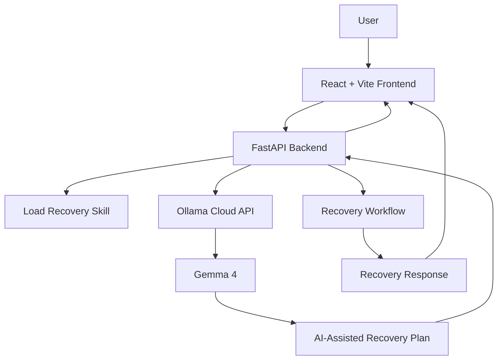

# 🛡️ FallbackForge
### Intelligent API Failure Recovery with AI-Powered Strategies

**Building more resilient APIs — one failure at a time.**

FallbackForge is a developer-focused project designed to explore how API failures can be handled more intelligently through recovery strategies, configurable retries, fallback mechanisms, and AI-assisted recovery planning.

Instead of treating every failed API request as the end of a workflow, FallbackForge aims to help developers understand failures and identify practical recovery actions.

<p align="center">
  <strong>Resilience • Intelligent Recovery • Developer Experience</strong>
</p>

---

## 📌 Table of Contents

- [Overview](#-overview)
- [Why FallbackForge?](#-why-fallbackforge)
- [Key Features](#-key-features)
- [How It Works](#-how-it-works)
- [Technology Stack](#-technology-stack)
- [Project Architecture](#-project-architecture)
- [Getting Started](#-getting-started)
- [API Endpoints](#-api-endpoints)
- [AI Integration](#-ai-integration)
- [Security](#-security)
- [Roadmap](#-roadmap)
- [Contributing](#-contributing)
- [Author](#-author)

## 🌟 Overview

Modern applications depend on APIs, but APIs can fail because of network issues, rate limits, service outages, timeouts, and unexpected responses.

FallbackForge explores a structured approach to API recovery by combining a frontend interface, a FastAPI backend, configurable recovery options, and an AI integration using Ollama Cloud with Gemma 4.

The goal is to make recovery planning easier to understand, configure, and improve.

## ❓ Why FallbackForge?

Traditional error handling often focuses on reporting that something went wrong. Reliable systems also need to consider what should happen next.

FallbackForge focuses on:

- **Resilience:** Explore strategies for handling API failures.
- **Recovery planning:** Generate AI-assisted suggestions for recovery scenarios.
- **Configurability:** Work with retry limits and fallback strategy options.
- **Clarity:** Make recovery behavior easier to understand through a frontend interface.
- **Practical learning:** Explore backend APIs, AI integration, and reliability engineering in one project.

## ✨ Key Features

- 🧠 **AI-assisted recovery planning** — Integrates with Ollama Cloud and the Gemma 4 model to generate recovery plans.
- 🔁 **Configurable retries** — Supports a maximum retry count as an input to recovery planning.
- 🛟 **Fallback strategies** — Includes a configurable fallback strategy in the recovery workflow.
- ⏱️ **Retry-After awareness** — Supports a setting to respect `Retry-After` behavior.
- ⚙️ **FastAPI backend** — Exposes API endpoints for health checks, AI connection testing, and recovery-plan requests.
- 🖥️ **Frontend interface** — Provides a user-facing interface for interacting with the project.
- 🧪 **Demo-mode handling** — The backend includes a demo-mode path when AI recovery-plan generation encounters configuration or request errors.

*Feature availability and behavior depend on the current implementation and configuration.*

## 🔄 How It Works

1. **Configure the scenario:** Provide a service name, description, failure type, retry limit, and fallback preferences.
2. **Send the request:** The frontend communicates with the FastAPI backend.
3. **Process the scenario:** The backend loads its recovery-skill instructions and prepares the request.
4. **Generate a plan:** The backend requests an AI-assisted recovery plan through Ollama Cloud.
5. **Handle failures:** The application includes a demo-mode path for specified AI configuration or request errors.
6. **Review the result:** The recovery response is returned to the client.

## 🧰 Technology Stack

| Technology | Purpose |
|---|---|
| React | Frontend user interface |
| Vite | Frontend development and build tooling |
| Python | Backend implementation |
| FastAPI | REST API framework |
| Ollama Cloud | Hosted model API integration |
| Gemma 4 | AI model used for recovery-plan generation |
| Git & GitHub | Version control and collaboration |

## 🏗️ Project Architecture



The frontend handles user interaction, while the backend coordinates the recovery workflow and AI integration.

## 🚀 Getting Started

### Prerequisites

Install the following before running the project:

- [Node.js and npm](https://nodejs.org/)
- [Python 3.10+](https://www.python.org/)
- [Git](https://git-scm.com/)
- An Ollama Cloud API key for AI-powered recovery planning

### 1. Clone the repository

```bash
git clone https://github.com/shristibajpai/FallBackForge.git
cd FallBackForge
```

### 2. Install frontend dependencies

```bash
npm install
```

### 3. Configure the backend

The backend is maintained separately from this frontend repository in the current project layout.

From the overall project root, install the Python dependencies using the project's requirements file:

```bash
python -m venv .venv
```

Activate the environment on Windows:

```powershell
.\.venv\Scripts\Activate.ps1
```

Install dependencies:

```bash
pip install -r requirements.txt
```

Configure the backend environment in `Backend/.env`:

```dotenv
OLLAMA_API_KEY=your_ollama_api_key
OLLAMA_URL=https://ollama.com/api/chat
OLLAMA_MODEL=gemma4
```

Replace the placeholder with your own API key. Never commit real API keys or secrets to GitHub.

### 4. Start the backend

Run this command from the overall project root, where the `Backend` package is located:

```bash
python -m uvicorn Backend.main:app --reload
```

The backend should be available at:

`http://127.0.0.1:8000`

Explore the interactive API documentation at:

`http://127.0.0.1:8000/docs`

### 5. Start the frontend

In a separate terminal, navigate to the frontend repository:

```bash
cd FallbackForge
npm run dev
```

Open the local URL printed by Vite in your terminal.

> **Note:** The backend and frontend must be available at their configured URLs. If the frontend runs on a different port, ensure the backend's CORS configuration allows that origin.

## 🔌 API Endpoints

The backend exposes the following endpoints:

| Method | Endpoint | Purpose |
|---|---|---|
| `GET` | `/health` | Checks backend health and reports whether the recovery skill file is available |
| `GET` | `/api/ollama/status` | Reports the configured Ollama provider, model, URL, and whether an API key is configured |
| `POST` | `/api/ollama/test` | Tests the Ollama connection; no request body is required |
| `POST` | `/api/recovery-plan` | Accepts a recovery scenario and returns a recovery-plan response |

Use the interactive Swagger UI at `/docs` to inspect request schemas and test the endpoints.

### Example: Check backend health

```bash
curl http://127.0.0.1:8000/health
```

### Example: Test the AI connection

```bash
curl -X POST http://127.0.0.1:8000/api/ollama/test
```

## 🤖 AI Integration

FallbackForge uses Ollama Cloud as the model API provider and Gemma 4 as its configured model.

The backend is responsible for preparing recovery-related inputs, sending requests to the model API, and processing the response.

The integration also includes connection testing and error handling for configuration and request failures.

**Important:** Access to the hosted model depends on valid credentials, network connectivity, and the provider's current service and usage policies.

## 🔐 Security

Security is an important consideration when working with API recovery systems and external AI services.

- Store credentials in environment variables or a local `.env` file.
- Never push API keys, access tokens, or other secrets to GitHub.
- Keep `.env` files out of version control.
- Validate inputs before processing recovery requests.
- Configure CORS for trusted frontend origins.
- Review recovery actions carefully before using them in production systems.

FallbackForge is a development project and should not be considered production-ready without additional testing, security review, and operational safeguards.

## 🗺️ Roadmap

Potential improvements include:

- [ ] Add comprehensive automated tests for recovery scenarios.
- [ ] Improve handling of rate limits, timeouts, and transient failures.
- [ ] Add structured recovery logs and execution traces.
- [ ] Expand recovery strategies and policy customization.
- [ ] Improve error messages and recovery-plan presentation.
- [ ] Add deployment instructions and production configuration guidance.
- [ ] Introduce monitoring and recovery metrics.

## 🤝 Contributing

Contributions, suggestions, and feedback are welcome.

1. Fork the repository.
2. Create a feature branch.
3. Make your changes and test them.
4. Commit with a descriptive message.
5. Open a pull request explaining your changes.

For bugs or feature requests, open an issue in the GitHub repository.

## 👩‍💻 Author

**Shristi Bajpai**

GitHub: [@shristibajpai](https://github.com/shristibajpai)

If you find this project interesting, consider giving the repository a ⭐ and sharing feedback.

---

<p align="center">
  <i>Exploring smarter recovery for more resilient applications.</i>
</p>
